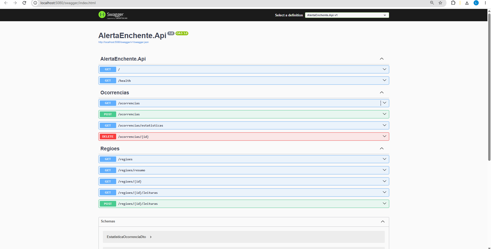
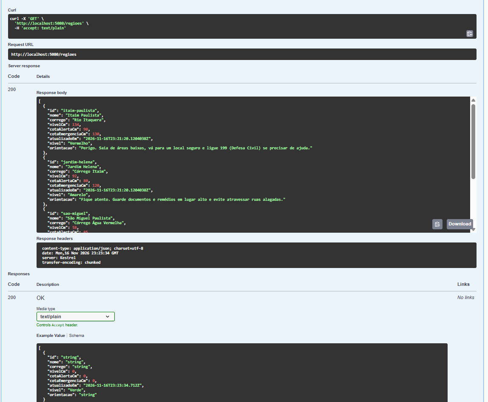
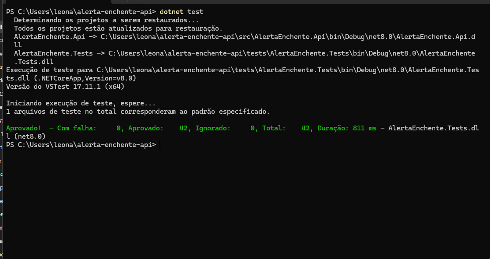

# AlertaEnchente · API (CitizenTech)

Entrega de **C# Software Development** · FIAP · Engenharia de Software (3º ano) · Global Solution 2026.2

Backend em **C# / .NET (Web API + Entity Framework Core + SQLite)** da CitizenTech **AlertaEnchente**. Ele guarda as regiões monitoradas, as medições do nível dos córregos e as ocorrências registradas pelos moradores, calcula o farol de risco (verde, amarelo ou vermelho) e serve esses dados ao app mobile.

## Equipe

| Integrante | RM |
|---|---|
| Arthur Silva | RM553320 |
| Eduardo Escudero | RM556527 |
| Leonardo Prado | RM556824 |
| Davi Vieira | RM556798 |
| Luca Monteiro | RM556906 |

**Nome do grupo:** AlertaEnchente

## Ficha da CitizenTech

| Campo | Preenchimento |
|---|---|
| Nome da CitizenTech | AlertaEnchente |
| Cidade e bairro | São Paulo, Jardim Helena (Zona Leste) |
| Cidadão beneficiado | Moradores e pequenos comerciantes de áreas alagáveis |
| Problema, em uma frase | Moradores de áreas alagáveis recebem os avisos de enchente tarde demais para proteger pessoas e bens. |
| Como funciona | A API recebe as medições do nível dos córregos, calcula o risco de cada região e entrega ao app o estado do farol e a orientação do que fazer. O morador também registra problemas (rua alagada, bueiro entupido) pela API. |
| O que cada parte faz | C# (este repositório): backend e regras de risco. Mobile: app do cidadão. Cybersecurity: proteção de dados pessoais. Infraestrutura Linux: hospedagem e monitoramento. Demais disciplinas: sensores, previsão e testes. |
| Indicador de impacto | Tempo entre a medição do córrego e o aviso chegar ao morador; ocorrências registradas por região |
| ODS conectados | ODS 9, ODS 11 e ODS 13 |

## Como rodar

Pré-requisito: **.NET SDK** (8 ou mais novo). Confira com `dotnet --version`.

```bash
git clone https://github.com/Leonardomunhoz12/alerta-enchente-api.git
cd alerta-enchente-api
dotnet restore
dotnet run --project src/AlertaEnchente.Api
```

A API sobe em **http://localhost:5080** e abre a documentação (Swagger) em **http://localhost:5080/swagger**. O banco SQLite (`alertaenchente.db`) é criado sozinho na primeira execução, com 4 regiões e 3 ocorrências de demonstração.

Para rodar os testes unitários:

```bash
dotnet test
```

## Endpoints

| Método | Rota | O que faz |
|---|---|---|
| GET | `/regioes` | Lista as regiões com nível atual, risco e orientação |
| GET | `/regioes/resumo` | Quantas regiões estão em verde, amarelo e vermelho |
| GET | `/regioes/{id}` | Detalhes de uma região |
| GET | `/regioes/{id}/leituras?limite=20` | Últimas medições do córrego |
| POST | `/regioes/{id}/leituras` | Registra uma medição e recalcula o risco |
| GET | `/ocorrencias?regiaoId=&tipo=` | Lista ocorrências, com filtros opcionais |
| GET | `/ocorrencias/estatisticas` | Total de ocorrências por tipo |
| POST | `/ocorrencias` | Registra uma ocorrência |
| DELETE | `/ocorrencias/{id}` | Apaga uma ocorrência |
| GET | `/health` | Verificação de saúde |

Exemplo de resposta de `GET /regioes/itaim-paulista`:

```json
{
  "id": "itaim-paulista",
  "nome": "Itaim Paulista",
  "corrego": "Rio Itaquera",
  "nivelCm": 134,
  "cotaAlertaCm": 90,
  "cotaEmergenciaCm": 130,
  "atualizadoEm": "2026-11-15T22:30:00Z",
  "nivel": "Vermelho",
  "orientacao": "Perigo. Saia de áreas baixas, vá para um local seguro e ligue 199 (Defesa Civil) se precisar de ajuda."
}
```

## Como a solução aplica os conteúdos da disciplina

| Conteúdo | Onde está |
|---|---|
| **POO** (herança, encapsulamento, polimorfismo) | `Domain/`: `EntidadeBase` é a classe base de `Regiao`, `LeituraNivel` e `Ocorrencia`. As entidades validam os próprios dados no construtor e só mudam por métodos (`Regiao.RegistrarLeitura`). `IRiscoCalculadora` tem duas implementações (`CalculadoraPorCotas` e `CalculadoraComTendencia`, um Decorator). |
| **Interfaces e injeção de dependência** | `IRegiaoService`, `IOcorrenciaService`, `IRiscoCalculadora` e `IOrientacaoProvider` são registradas em `Program.cs` e recebidas pelos construtores. A regra de risco muda por configuração (`Risco:UsarTendencia` em `appsettings.json`), sem alterar código. |
| **Web API REST** | `Controllers/`: rotas REST, códigos HTTP corretos (200, 201, 204, 400, 404), validação por DataAnnotations e tratamento global de erros (ProblemDetails). Documentada com Swagger. |
| **Entity Framework Core** | `Data/AppDbContext.cs`: mapeamento Fluent API, chaves, índices e relacionamentos (Regiao 1:N LeituraNivel e Ocorrencia), com SQLite. `DbSeeder` carrega os dados iniciais. |
| **LINQ** | `Services/`: `Where`, `OrderByDescending`, `ThenBy`, `Take`, `GroupBy`, `Select`, `ToDictionary` em consultas de filtro, ranking, estatísticas e resumo de risco. |
| **Programação assíncrona** | Todos os serviços e controllers usam `async/await` com `CancellationToken` (`ToListAsync`, `SaveChangesAsync`, `AnyAsync`). |
| **Testes unitários** | `tests/AlertaEnchente.Tests` (xUnit): regras de risco, domínio, serviços com SQLite em memória (casos positivos e negativos). |

### Estrutura

```
src/AlertaEnchente.Api/
  Controllers/   RegioesController, OcorrenciasController
  Domain/        entidades, enums e regras de risco
  Data/          AppDbContext e DbSeeder
  Dtos/          contratos de entrada e saída da API
  Services/      regras de negócio (interfaces e implementações)
  Program.cs     configuração, injeção de dependência e pipeline
tests/AlertaEnchente.Tests/   testes unitários (xUnit)
```

## Integração com o app mobile

O app mobile (repositório `alerta-enchente-mobile`) consome `GET /regioes` neste mesmo formato. Para usar esta API no lugar dos dados de demonstração:

```bash
EXPO_PUBLIC_API_URL=http://localhost:5080 npx expo start --web
```

(No PowerShell: `$env:EXPO_PUBLIC_API_URL="http://localhost:5080"; npx expo start --web`.) O CORS já está liberado.

## Evidências da aplicação

| Swagger | Resposta de `GET /regioes` | Testes passando |
|---|---|---|
|  |  |  |

## Vídeo

(link do vídeo, se houver)
